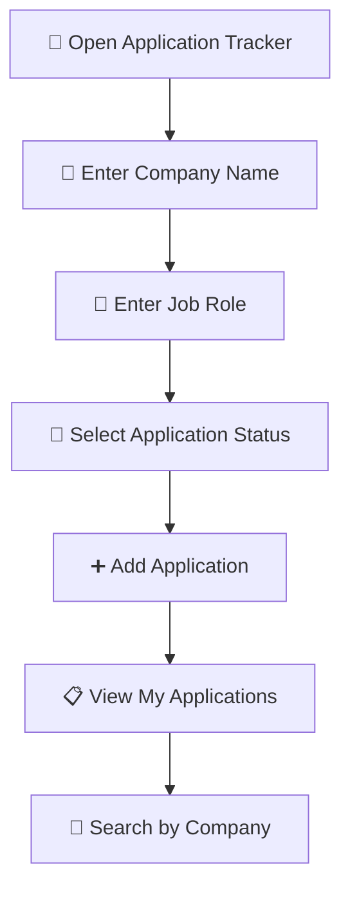

# 💼 Application Tracker
### Your Job Search. Organized. Tracked. Under Control.

  
  
  

  **A simple and organized way to manage your job applications and track your career journey.**

---

## 🌟 Overview

**Application Tracker** is a web-based job application management tool designed to help job seekers organize their applications in one place.

Instead of managing application details manually, users can add company names, job roles, track application statuses, and search through their application records.

Whether you're applying to your first job or managing multiple opportunities, Application Tracker helps keep your job search organized.

---

## ✨ Features

| Feature | Description |
|---|---|
| 🏢 Company Details | Enter the company name for each application. |
| 💼 Job Role Tracking | Record the position you applied for. |
| 📌 Application Status | Track Applied, Interview, Rejected, and Selected statuses. |
| 🔎 Company Search | Search applications using company names. |
| 📋 Application List | View your job applications in one place. |
| ⚡ Simple Interface | Lightweight web interface built with frontend technologies. |

---

## 🖥️ Application Workflow

---

## 🛠️ Tech Stack

  
  
  

- **HTML5** — Application structure
- **CSS3** — User interface
